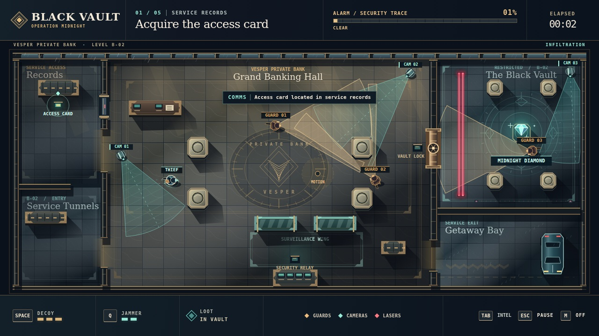

# BLACK VAULT — Operation Midnight

[](https://make.fun/bounty/best-heist-game-20261122-0559)
[](https://make.fun/bounty/best-heist-game-20261122-0559)
[](https://make.fun/bounty/best-heist-game-20261122-0559)

**Every second is stolen.** A midnight storm covers your entry into the tunnels beneath Vesper Private Bank. Take the access card, cut the surveillance relay, pick all three vault pins, and bring the stolen Midnight Diamond back to the getaway car.



## Play

Serve `game/` with any static HTTP server and open its root in desktop Chromium or Chrome. The included server runs on Node.js 22.18 or later with TypeScript stripping enabled.

```sh
node serve.ts
```

Open <http://localhost:8080>. The game has no installation, build step, remote assets, or runtime network dependencies.

| Input | Action |
| --- | --- |
| WASD or arrows | Move |
| Shift | Sprint, at the cost of audible footsteps |
| C or Ctrl | Crouch to reduce sight exposure and bypass the motion sensor |
| E | Interact, align a pin, or enter the getaway car |
| Space or left click | Throw a decoy toward the cursor. Without a pointer target, Space throws forward |
| Q | Jam active cameras in range for 6.8 seconds |
| Tab | Toggle mission intel |
| Esc | Pause or step away from the vault mechanism |
| R | Restart the mission |
| M | Toggle audio |

## The heist

- **Routes.** The keycard opens a north shortcut. The exposed hall is faster, while the lower service corridor has more cover. Blocking objects match the map, and warm patrol cones and mint camera cones stop at walls, columns, and furniture.
- **Guards.** Three guards patrol, pause, inspect suspicious movement, investigate sprint noise and thrown decoys, pursue visible targets, search the last-known location, and return to their routes. Distance, angle, and stance affect detection.
- **Surveillance.** Three cameras sweep on independent cycles. Two share the relay, which also cuts the lobby motion sensor and reduces accumulated trace. The vault camera and cycling laser grid run on backup power. Jam a camera, time its turn, or use cover. Wait for a laser to go dark, or travel around its ends.
- **Equipment.** Three decoys redirect guards on landing. Two jammer charges disable active cameras nearby. A pulse outside camera range keeps the charge.
- **Vault.** Use the lock beside the gold threshold and stop each rotating needle inside the mint arc. A missed pin raises security trace and briefly stalls the mechanism. Opening the gate lets you reach the diamond display.
- **Extraction.** Pick up the diamond and get to the car. Trace cools after you break contact before stealing the gem. Once you have it, pressure mounts until extraction. A guard can intercept you at close range, and a full alarm starts a seven-second lockdown timer. The result screen records time, detections, alarm peak, recovered loot, and rating.
- **Presentation.** Original Canvas art uses marble veining, Art Deco inlays, illustrated fixtures, hard shadows, animated rain, and a faceted diamond. Web Audio synthesizes the rain, footsteps, signals, pin clicks, alarm pulses, and getaway cue locally.

## Judging captures

| Capture | Live game state |
| --- | --- |
| [01-heist.jpg](screenshots/01-heist.jpg) | The thief crosses the Grand Banking Hall with guards, their cones, live cameras, the diamond, and the alarm visible together. |
| [02-security.jpg](screenshots/02-security.jpg) | The thief uses a marble column for cover while a decoy draws a guard off route. |
| [03-vault.jpg](screenshots/03-vault.jpg) | A vault pin is in progress beside the active lasers and the guarded display. |
| [04-escape.jpg](screenshots/04-escape.jpg) | The display is empty, loot is secured, and the thief approaches the getaway car. |

## Validation and packaging

```sh
node --test tests/mission.test.mjs
MAKEFUN_OUTPUT_DIR=out node main.ts
```

The simulation tests cover solid collision, stances, sight and occlusion, hearing, guard search, cameras and jamming, lasers, the motion sensor, trace recovery and lockdown, the pin sequence, and a full extraction. The entrypoint copies the static game and four judging captures, then writes the official `makefun/dossier/v1` dossier with the unchanged kit helper.

The Chromium playtest finished a full run in 24 seconds with three detection incidents, an 89% peak alarm, and a Professional rating. A second run confirmed guard capture and retry. The playtest recorded zero external page requests, failed assets, or console errors.

License is MIT.
